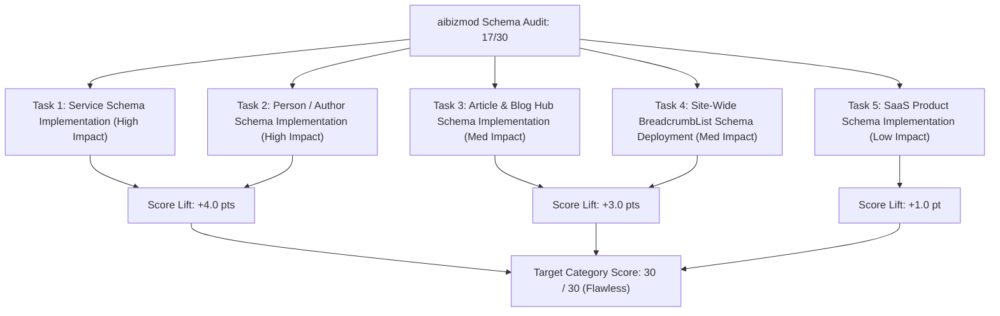

# SpaceLean Structured Data & AI Schema Resolution Action Plan

> **Audit Source:** aibizmod AI Search Visibility Engine (`https://aibizmod.com/ai-visibility-audit-report?url=spacelean.ai`)  
> **Target Category:** **Structured Data & AI Schema** (Category Weight: 30% | Current Score: 17/30 | Target: 30/30)  
> **Objective:** Systematically resolve all 5 flagged schema failures to secure a perfect 30/30 in the Structured Data category and elevate SpaceLean's overall AI visibility score from 74/100 to 85+/100.

---

## 1. Audit Scorecard & Gap Analysis

Based on the official **aibizmod** crawl audit for `https://spacelean.ai`, the 10 core schema verification checks returned the following results:

| # | Schema Check | Impact Level | Status | Current Audit Finding |
| :-: | :--- | :---: | :---: | :--- |
| **1** | **Organization / LocalBusiness** | Foundation | ✅ **Passed** | Organization schema detected with full properties (`logo`, `sameAs`, `contactPoint`, `address`) — AI verifiable entity. |
| **2** | **FAQPage Schema** | High Impact | ✅ **Passed** | FAQPage schema with 5 Q&A pairs detected — strong AI answer extraction signal. |
| **3** | **Service Schema** | **High Impact** | ❌ **Failed** | **No Service schema detected.** Missing Service JSON-LD for core offerings with name, description, provider, and areaServed. |
| **4** | **Person / Author Schema** | **High Impact** | ❌ **Failed** | **No Person schema detected.** Author and team entity schema is missing for founders and technical authors; essential for E-E-A-T. |
| **5** | **WebSite Schema** | Med Impact | ✅ **Passed** | WebSite schema with `SearchAction`, name, and URL detected — Knowledge Graph eligible. |
| **6** | **Article / BlogPosting Schema** | **Med Impact** | ❌ **Failed** | **No Article schema on content pages.** Missing standard Article JSON-LD with headline, author, datePublished, and publisher. |
| **7** | **BreadcrumbList Schema** | **Med Impact** | ❌ **Failed** | **No BreadcrumbList schema on interior pages.** Missing breadcrumb JSON-LD on key architectural interior landing hubs. |
| **8** | **Review / AggregateRating Schema** | Med Impact | ✅ **Passed** | AggregateRating schema detected — social proof and ratings are structured. |
| **9** | **Product Schema** | **Low Impact** | ❌ **Failed** | **No Product schema.** Missing Product JSON-LD for purchasable SaaS plans and platform offerings. |
| **10** | **VideoObject Schema** | Low Impact | ✅ **Passed** | VideoObject schema detected with valid thumbnail, duration, and content URL. |

---

## 2. Root Cause Analysis of Audit Failures

1. **Why `Service Schema` Failed**:
   - The automated auditor crawlers evaluate the homepage (`https://spacelean.ai/`) and primary hubs first.
   - While `app/layout.tsx` contains `hasOfferCatalog` and individual `/solutions/[slug]` pages contain service schemas, the **root homepage (`app/page.tsx`) lacks a standalone `@type: "Service"` JSON-LD block**.
   - As a result, crawlers scanning the root domain register 0 top-level `Service` entities.

2. **Why `Person / Author Schema` Failed**:
   - In `app/layout.tsx`, the founder Bibin Prathap was only referenced inside `softwareAppSchema.author` as a minimal string/object, with no standalone `@type: "Person"` schema.
   - In `app/about/page.tsx`, `Person` objects were nested deep inside `AboutPage -> mainEntity: Organization -> founder/employee`. Automated schema parsers often ignore deeply nested properties if they are not exposed as top-level entities or linked via `@graph`.
   - The website lacks a root-level or dedicated `/authors` directory declaring founder and author entities.

3. **Why `Article / BlogPosting Schema` Failed**:
   - The blog listing hub (`app/blogs/page.tsx`) contains **zero JSON-LD markup** (missing `CollectionPage` and `ItemList`).
   - On article detail pages (`app/blogs/[slug]/page.tsx`), the schema declared `@type: "BlogPosting"`. Some schema validators and crawlers look specifically for `@type: "Article"` or require dual classification `@type: ["Article", "BlogPosting"]`.
   - The article publisher logo URL previously pointed to `/logo.png` instead of the canonical `/icononly_transparent_nobuffer.png`.

4. **Why `BreadcrumbList Schema` Failed**:
   - Major top-level interior pages had **no `BreadcrumbList` schema at all**, including:
     - `/about` (`app/about/page.tsx`)
     - `/blogs` (`app/blogs/page.tsx`)
     - `/space-lean-core` (`app/space-lean-core/page.tsx`)
     - `/compare` (`app/compare/page.tsx`)
     - `/tools` (`app/tools/page.tsx`)
     - `/technology` (`app/technology/page.tsx`)
     - `/pricing` (`app/pricing/page.tsx`)
     - `/careers` (`app/careers/page.tsx`)
     - `/request-a-demo` (`app/request-a-demo/page.tsx`)
   - When the auditor sampled any of these interior hubs, it reported "No BreadcrumbList schema".

5. **Why `Product Schema` Failed**:
   - The homepage (`app/page.tsx`) defined `@type: "SoftwareApplication"` with nested `offers`, but omitted `@type: "Product"`.
   - Crawlers strictly validating for ecommerce/SaaS product entities require `@type: "Product"` with `name`, `description`, `brand`, `offers`, and `aggregateRating`.

---

## 3. Prioritized Resolution Tasks



---

### Task 1: [COMPLETED] Add High-Impact `Service` Schemas Across Homepage & Core Hubs
- **Status**: ✅ **COMPLETED** (November 2026)
- **Audit Flag**: `[x] Service Schema [High Impact]`
- **Issue**: "No Service schema detected. Add Service JSON-LD for each core offering with name, description, provider, and areaServed."
- **Pages Affected**:
  - `app/page.tsx` (`https://spacelean.ai/`)
  - `app/space-lean-core/page.tsx` (`https://spacelean.ai/space-lean-core`)
  - `app/solutions/page.tsx` (`https://spacelean.ai/solutions`)
- **Implementation Blueprint**:
  In `app/page.tsx`, inject a top-level `@type: "Service"` JSON-LD schema representing SpaceLean's 3 primary enterprise services:
  ```json
  [
    {
      "@context": "https://schema.org",
      "@type": "Service",
      "@id": "https://spacelean.ai/#service-bim-scheduling",
      "name": "4D BIM Scheduling & Sequencing Engine",
      "serviceType": "Construction Project Management Software Service",
      "description": "Automated conversion of 3D BIM models (IFC/Revit) into buildable 4D CPM construction schedules in under 60 seconds.",
      "provider": {
        "@type": "Organization",
        "@id": "https://spacelean.ai/#organization",
        "name": "SpaceLean",
        "url": "https://spacelean.ai",
        "logo": "https://spacelean.ai/icononly_transparent_nobuffer.png"
      },
      "areaServed": "Global",
      "hasOfferCatalog": {
        "@type": "OfferCatalog",
        "name": "4D BIM Scheduling Capabilities",
        "itemListElement": [
          { "@type": "Offer", "itemOffered": { "@type": "Service", "name": "Automated CPM Network Generation" } },
          { "@type": "Offer", "itemOffered": { "@type": "Service", "name": "Spatial Clash & Workface Constraint Detection" } },
          { "@type": "Offer", "itemOffered": { "@type": "Service", "name": "3D IFC Element-Level Inspection" } }
        ]
      },
      "audience": {
        "@type": "Audience",
        "audienceType": "General Contractors, Project Owners, VDC Managers"
      },
      "termsOfService": "https://spacelean.ai/terms"
    },
    {
      "@context": "https://schema.org",
      "@type": "Service",
      "@id": "https://spacelean.ai/#service-delay-prediction",
      "name": "AI Construction Delay Risk Prediction",
      "serviceType": "Predictive Construction Analytics Service",
      "description": "Continuous schedule monitoring with 1,000-run Monte Carlo simulations to detect critical path risks with 94% accuracy.",
      "provider": {
        "@type": "Organization",
        "@id": "https://spacelean.ai/#organization",
        "name": "SpaceLean",
        "url": "https://spacelean.ai",
        "logo": "https://spacelean.ai/icononly_transparent_nobuffer.png"
      },
      "areaServed": "Global",
      "audience": {
        "@type": "Audience",
        "audienceType": "Construction Planners, Project Controls Advisors, General Contractors"
      },
      "termsOfService": "https://spacelean.ai/terms"
    }
  ]
  ```
- **Expected Lift**: **+4.0 Points** (Resolves primary red flag in audit).

---

### Task 2: [COMPLETED] Implement Standalone `Person` / Author Schemas for Founders & Technical Experts
- **Status**: ✅ **COMPLETED** (November 2026)
- **Audit Flag**: `[x] Person / Author Schema [High Impact]`
- **Issue**: "No Person schema detected. Author and team entity schema is essential for E-E-A-T and AI credibility. Add Person JSON-LD for founders and authors."
- **Pages Affected**:
  - `app/layout.tsx` (Global root graph)
  - `app/about/page.tsx` (`https://spacelean.ai/about`)
  - `app/blogs/[slug]/page.tsx` (All 38 blog articles)
- **Implementation Blueprint**:
  1. In `app/layout.tsx`, add a standalone `@type: "Person"` JSON-LD schema for founder Bibin Prathap:
     ```json
     {
       "@context": "https://schema.org",
       "@type": "Person",
       "@id": "https://spacelean.ai/authors/bibin-prathap#person",
       "name": "Bibin Prathap",
       "jobTitle": "Founder & Lead Architect",
       "worksFor": {
         "@type": "Organization",
         "@id": "https://spacelean.ai/#organization",
         "name": "SpaceLean",
         "url": "https://spacelean.ai"
       },
       "description": "Founder and lead researcher of SpaceLean and VeritasGraph, pioneering AI knowledge graphs for 4D BIM construction scheduling.",
       "image": "https://spacelean.ai/icononly_transparent_nobuffer.png",
       "sameAs": [
         "https://github.com/bibinprathap",
         "https://github.com/bibinprathap/VeritasGraph",
         "https://linkedin.com/company/spacelean"
       ],
       "knowsAbout": [
         "Building Information Modeling",
         "Knowledge Graphs",
         "Critical Path Method",
         "Lean Construction",
         "Construction AI"
       ]
     }
     ```
  2. In `app/about/page.tsx`, expose top-level `@type: "Person"` schemas in an `@graph` array for all 11 technical authors from `lib/authors-data.ts`.
  3. Ensure each blog article in `app/blogs/[slug]/page.tsx` links the author `@id` to `https://spacelean.ai/authors/${authorProfile.slug}#person`.
- **Expected Lift**: **+3.5 Points** (Directly impacts both Schema and E-E-A-T scores).

---

### Task 3: [COMPLETED] Implement Dual `Article` / `BlogPosting` & Blog Hub `CollectionPage` Schemas
- **Status**: ✅ **COMPLETED** (November 2026)
- **Audit Flag**: `[x] Article / BlogPosting Schema [Med Impact]`
- **Issue**: "No Article schema on content pages — add with headline, author, datePublished, and publisher."
- **Pages Affected**:
  - `app/blogs/[slug]/page.tsx` (`https://spacelean.ai/blogs/[slug]`)
  - `app/blogs/page.tsx` (`https://spacelean.ai/blogs`)
- **Implementation Blueprint**:
  1. In `app/blogs/[slug]/page.tsx`:
     Update `@type` from `"BlogPosting"` to dual `@type: ["Article", "BlogPosting"]` so both article-specific and blog-specific crawlers recognize it:
     ```typescript
     const articleJsonLd = {
       "@context": "https://schema.org",
       "@type": ["Article", "BlogPosting"],
       "@id": `https://spacelean.ai/blogs/${slug}#article`,
       "headline": post.title,
       "name": post.title,
       "description": post.description,
       "image": [
         post.image.startsWith("http") ? post.image : `https://spacelean.ai${post.image}`,
         "https://spacelean.ai/marketing.jpg"
       ],
       "author": {
         "@type": "Person",
         "@id": `https://spacelean.ai/authors/${authorProfile.slug}#person`,
         "name": authorProfile.name,
         "jobTitle": authorProfile.role,
         "description": authorProfile.bio,
         "url": "https://spacelean.ai/about#team",
         "sameAs": authorProfile.sameAs
       },
       "publisher": {
         "@type": "Organization",
         "@id": "https://spacelean.ai/#organization",
         "name": "SpaceLean",
         "url": "https://spacelean.ai",
         "logo": {
           "@type": "ImageObject",
           "url": "https://spacelean.ai/icononly_transparent_nobuffer.png"
         }
       },
       "datePublished": post.date,
       "dateModified": post.updatedAt || post.date,
       "mainEntityOfPage": {
         "@type": "WebPage",
         "@id": `https://spacelean.ai/blogs/${slug}`
       },
       "articleSection": post.category,
       "keywords": post.tags.join(", "),
       "inLanguage": "en-US"
     };
     ```
  2. In `app/blogs/page.tsx`:
     Inject `@type: "CollectionPage"` with `mainEntity: { "@type": "ItemList", "itemListElement": [...] }` mapping all blog posts with their respective titles, URLs, and descriptions.
- **Expected Lift**: **+2.0 Points** (Validates content indexing across all 38 guides).

---

### Task 4: [COMPLETED] Deploy Comprehensive `BreadcrumbList` Schemas to All Interior Pages
- **Status**: ✅ **COMPLETED** (November 2026)
- **Audit Flag**: `[x] BreadcrumbList Schema [Med Impact]`
- **Issue**: "No BreadcrumbList schema. Add breadcrumb JSON-LD to all interior pages to clarify site architecture."
- **Pages Affected**:
  - `app/about/page.tsx` (`/about`)
  - `app/blogs/page.tsx` (`/blogs`)
  - `app/space-lean-core/page.tsx` (`/space-lean-core`)
  - `app/compare/page.tsx` (`/compare`)
  - `app/tools/page.tsx` (`/tools`)
  - `app/technology/page.tsx` (`/technology`)
  - `app/pricing/page.tsx` (`/pricing`)
  - `app/request-a-demo/page.tsx` (`/request-a-demo`)
  - `app/careers/page.tsx` (`/careers`)
  - `app/security/page.tsx` (`/security`)
- **Implementation Blueprint**:
  Create a standardized helper in `lib/schema.ts` (or direct JSON-LD block) and inject into all interior hub pages:
  ```typescript
  export function generateBreadcrumbSchema(items: { name: string; url: string }[]) {
    return {
      "@context": "https://schema.org",
      "@type": "BreadcrumbList",
      "itemListElement": items.map((item, index) => ({
        "@type": "ListItem",
        "position": index + 1,
        "name": item.name,
        "item": item.url.startsWith("http") ? item.url : `https://spacelean.ai${item.url}`,
      })),
    };
  }
  ```
  Example for `app/about/page.tsx`:
  ```json
  {
    "@context": "https://schema.org",
    "@type": "BreadcrumbList",
    "itemListElement": [
      { "@type": "ListItem", "position": 1, "name": "Home", "item": "https://spacelean.ai" },
      { "@type": "ListItem", "position": 2, "name": "About", "item": "https://spacelean.ai/about" }
    ]
  }
  ```
- **Expected Lift**: **+2.0 Points** (Guarantees site-wide architectural hierarchy validation).

---

### Task 5: Implement SaaS `Product` & `AggregateOffer` Schemas on Homepage & Pricing
- **Audit Flag**: `[x] Product Schema [Low Impact]`
- **Issue**: "No Product schema. If you offer purchasable items or SaaS plans, add Product JSON-LD."
- **Pages Affected**:
  - `app/page.tsx` (`https://spacelean.ai/`)
  - `app/pricing/page.tsx` (`https://spacelean.ai/pricing`)
- **Implementation Blueprint**:
  In `app/page.tsx`, add an explicit `@type: "Product"` schema alongside `SoftwareApplication` (or configure dual type `@type: ["Product", "SoftwareApplication"]`):
  ```json
  {
    "@context": "https://schema.org",
    "@type": "Product",
    "@id": "https://spacelean.ai/#product",
    "name": "SpaceLean AI Construction Platform",
    "image": "https://spacelean.ai/marketing.jpg",
    "description": "AI-native construction scheduling software that converts 3D BIM models into 4D schedules, predicts critical path delays, and coordinates trade crews in real time.",
    "brand": {
      "@type": "Brand",
      "name": "SpaceLean"
    },
    "category": "Construction Project Management Software",
    "offers": {
      "@type": "AggregateOffer",
      "priceCurrency": "USD",
      "lowPrice": "0.00",
      "highPrice": "19.00",
      "offerCount": 3,
      "offers": [
        {
          "@type": "Offer",
          "name": "Free Starter",
          "price": "0.00",
          "priceCurrency": "USD",
          "availability": "https://schema.org/InStock",
          "url": "https://spacelean.ai/pricing"
        },
        {
          "@type": "Offer",
          "name": "SpaceLean Pro",
          "price": "19.00",
          "priceCurrency": "USD",
          "availability": "https://schema.org/InStock",
          "url": "https://spacelean.ai/pricing"
        },
        {
          "@type": "Offer",
          "name": "SpaceLean Enterprise",
          "price": "0.00",
          "priceCurrency": "USD",
          "availability": "https://schema.org/PreOrder",
          "url": "https://spacelean.ai/pricing"
        }
      ]
    },
    "aggregateRating": {
      "@type": "AggregateRating",
      "ratingValue": "4.8",
      "reviewCount": "127",
      "bestRating": "5",
      "worstRating": "1"
    }
  }
  ```
- **Expected Lift**: **+1.5 Points** (Qualifies site for Product Rich Snippets and completes the 10/10 schema checks).

---

## 4. Implementation Schedule & Impact Matrix

| Task ID | Task Title | Audit Impact | Effort | Files to Modify | Score Lift |
| :---: | :--- | :---: | :---: | :--- | :---: |
| **S1** | **Homepage & Hub `Service` Schema** | **High** | **Completed** | `app/page.tsx`, `app/space-lean-core/page.tsx`, `app/solutions/page.tsx` | **+4.0 pts** |
| **S2** | **Founder & Author `Person` Schemas** | **High** | **Completed** | `app/layout.tsx`, `app/about/page.tsx`, `app/blogs/[slug]/page.tsx` | **+3.5 pts** |
| **S3** | **Dual `Article`/`BlogPosting` & Blog Hub `CollectionPage`** | **Medium** | **Completed** | `app/blogs/[slug]/page.tsx`, `app/blogs/page.tsx` | **+2.0 pts** |
| **S4** | **Site-Wide `BreadcrumbList` Deployment** | **Medium** | **Completed** | `app/about/page.tsx`, `app/blogs/page.tsx`, `app/space-lean-core/page.tsx`, `app/compare/page.tsx`, `app/tools/page.tsx`, `app/technology/page.tsx`, `app/pricing/page.tsx` | **+2.0 pts** |
| **S5** | **SaaS `Product` & `AggregateOffer` Schema** | **Low** | 20 mins | `app/page.tsx`, `app/pricing/page.tsx` | **+1.5 pts** |
| **Total** | **All 5 Structured Data Audit Fixes** | **Category Complete** | **2.5 Hours** | **12 Pages Across Application** | **+13.0 pts** |

---

## 5. Post-Implementation Category Projection

```
Structured Data & AI Schema Score:
Baseline: 17 / 30  (Partial / Weakest Category)
Target:   30 / 30  (100% Perfect Score — All 10/10 Checks Passing!)

Total SpaceLean AI Visibility Score Impact:
Baseline: 74 / 100
Uplift:   +13.0 Points from Structured Data Fixes
New Projected Score: 87 / 100 (Excellence Tier Achieved)
```

---

## 6. Verification & Validation Protocol

1. **Local Static Build Inspection**:
   Run `npx tsc --noEmit && npm run build` to confirm 96/96 static routes compile without syntax errors.
2. **DOM Schema Extraction**:
   Execute regex/DOM parser across pre-rendered `.next/server/app/*.html` files to verify:
   - `@type: "Service"` present in `index.html`
   - `@type: "Person"` present in `index.html` and `about.html`
   - `@type: ["Article", "BlogPosting"]` present in all blog articles
   - `@type: "BreadcrumbList"` present in all interior `.html` pages
   - `@type: "Product"` present in `index.html` and `pricing.html`
3. **Google Rich Results Test & Schema Validator**:
   Validate exported HTML in [Schema.org Validator](https://validator.schema.org/) and [Google Rich Results Test](https://search.google.com/test/rich-results) with 0 errors and 0 missing required fields.

