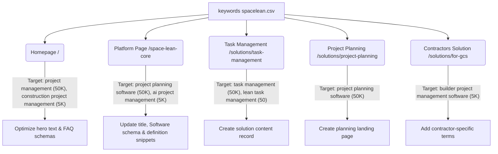

# SpaceLean SEO & GEO Keyword Planner Optimization Roadmap

This document outlines a prioritized search optimization and Generative Engine Optimization (GEO) roadmap for [SpaceLean](https://spacelean.ai) based on the Google Keyword Planner dataset (`keywords spacelean.csv`) and the structure of the SpaceLean repository.

The objective is to capture the search volume from high-volume, low-competition keywords (e.g., `project management` and `project planning software` with 50,000+ searches) and align the codebase with modern search visibility best practices and AI-citation prerequisites.

---

## Opportunity Overview: Keyword Insights

Based on the uploaded keyword statistics, the primary search clusters are:

| Keyword Cluster | Avg. Monthly Searches | Competition | Target Target Page |
| :--- | :--- | :--- | :--- |
| `project management` | 50,000 | Low | `/` (Homepage) |
| `project planning software` | 50,000 | Low | `/space-lean-core` (Platform Page) |
| `task management` | 50,000 | Low | `/features` (Features Directory) |
| `ai project management` | 5,000 | Medium | `/space-lean-core` (Platform Page) |
| `construction project management` | 5,000 | Low | `/` (Homepage) / `/solutions` |
| `construction software management` | 5,000 | Low | `/solutions/for-gcs` (General Contractors) |
| `builder project management software` | 5,000 | Low | `/solutions/for-gcs` (General Contractors) |
| `construction scheduling software` | 500 | Low | `/space-lean-core` (Platform Page) |
| `construction scheduling` | 500 | Low | `/space-lean-core` (Platform Page) |
| `lean project management` | 500 | Low | `/blogs/lean-project-management-software` |
| `infrastructure project management` | 500 | Low | `/solutions/infrastructure` |
| `bim project management software` | 50 | Low | `/space-lean-core` (Platform Page) |

---

## 30 Actionable Website Tasks

Below is the prioritized set of 30 specific, actionable tasks designed to optimize SpaceLean's SEO, structured schema, user experience, and AI search visibility.

---

### Phase 1: Technical & Crawler Foundations (Tasks 1–8)

#### [x] Task 1: Fix Relative Hreflang Tags in Solutions Metadata
* **Priority**: Critical
* **Category**: Technical SEO
* **Why this task is important**: Google's search crawlers require that regional language alternate links (`hreflang`) point to fully qualified absolute URLs. Relative paths (like `/solutions/for-gcs`) fail validation, causing search engines to ignore regional targeting and language versions.
* **Current issue**: The metadata objects in solutions pages feature relative links in their alternates block.
* **Implementation steps**:
  1. Open `app/solutions/page.tsx` and `app/solutions/[slug]/page.tsx`.
  2. Locate the `alternates` metadata object.
  3. Prepend all language alternate paths with `https://spacelean.ai` to make them absolute.
* **Files to update**:
  - [app/solutions/page.tsx](file:///home/user/Documents/spacelearn/app/solutions/page.tsx)
  - [app/solutions/[slug]/page.tsx](file:///home/user/Documents/spacelearn/app/solutions/%5Bslug%5D/page.tsx)
* **Suggested target keywords**: General brand crawlability
* **Expected SEO impact**: Very High
* **Estimated effort**: Small
* **Success criteria**: Validated absolute `hreflang` links in the HTML `<head>` on solutions routes.

---

#### [x] Task 2: Standardize Absolute Hreflang Tags in Comparison Metadata
* **Priority**: Critical
* **Category**: Technical SEO
* **Why this task is important**: Comparison pages capture searchers comparing software (e.g. "SpaceLean vs Procore"). Relative hreflangs here prevent correct indexing of target commercial comparison folders.
* **Current issue**: The dynamic comparison template contains relative alternate links.
* **Implementation steps**:
  1. Open `app/compare/[slug]/page.tsx`.
  2. Modify the `alternates.languages` configurations in the metadata generation helper.
  3. Replace relative paths with absolute `https://spacelean.ai/compare/[slug]` links.
* **Files to update**:
  - [app/compare/[slug]/page.tsx](file:///home/user/Documents/spacelearn/app/compare/%5Bslug%5D/page.tsx)
* **Suggested target keywords**: Brand vs competitor terms
* **Expected SEO impact**: Very High
* **Estimated effort**: Small
* **Success criteria**: Crawler tools report zero relative link warnings for comparison alternate headers.

---

#### [x] Task 3: Fix Hreflang Configurations in Dynamic Blog Metadata
* **Priority**: Critical
* **Category**: Technical SEO
* **Why this task is important**: Blogs drive organic traffic for long-tail educational queries (e.g., "what is lean construction planning"). Correct hreflang mapping ensures users in different regions land on the correct localized blog page.
* **Current issue**: The dynamic blog page layout uses relative strings for alternates.
* **Implementation steps**:
  1. Update `app/blogs/[slug]/page.tsx` within the metadata generation logic.
  2. Map languages (e.g., `en-US`, `en-IN`, `en-AE`) to absolute URLs starting with `https://spacelean.ai/blogs/[slug]`.
* **Files to update**:
  - [app/blogs/[slug]/page.tsx](file:///home/user/Documents/spacelearn/app/blogs/%5Bslug%5D/page.tsx)
* **Suggested target keywords**: `lean project management` (500 searches)
* **Expected SEO impact**: High
* **Estimated effort**: Small
* **Success criteria**: Clean indexability for regional English markets verified in Google Search Console.

---

#### [x] Task 4: Standardize Alternates on the Free AI Task Generator
* **Priority**: Critical
* **Category**: Technical SEO
* **Why this task is important**: Free tools are strong lead magnets. Standardizing alternate link structures ensures search engine crawler bots process the page successfully across domains.
* **Current issue**: The Free AI Task Generator metadata contains relative alternates.
* **Implementation steps**:
  1. Open `app/tool/page.tsx` and inspect the static metadata object.
  2. Ensure the alternates object uses absolute path formatting for the tool URI.
* **Files to update**:
  - [app/tool/page.tsx](file:///home/user/Documents/spacelearn/app/tool/page.tsx)
* **Suggested target keywords**: `ai project management` (5,000 searches)
* **Expected SEO impact**: High
* **Estimated effort**: Small
* **Success criteria**: Validated absolute URL canonical configurations in head layout outputs.

---

#### [x] Task 5: Fix CSS Syntax Error in globals.css Heading Ruleset
* **Priority**: Critical
* **Category**: Technical SEO
* **Why this task is important**: CSS syntax errors block browsers from compiling styling correctly, resulting in layout shifts and rendering issues. Layout stability is a primary Core Web Vital (CLS) ranking signal.
* **Current issue**: There is a missing semicolon in the heading styles blocks inside `app/globals.css` (around line 201), breaking subsequent element rules.
* **Implementation steps**:
  1. Inspect the CSS heading selectors in `app/globals.css`.
  2. Add a trailing semicolon to the `color: #301659` declaration.
* **Files to update**:
  - [app/globals.css](file:///home/user/Documents/spacelearn/app/globals.css)
* **Suggested target keywords**: User Experience & Page Rendering Stability
* **Expected SEO impact**: Medium
* **Estimated effort**: Small
* **Success criteria**: Next.js compilation warnings disappear; zero CLS issues in Chrome DevTools performance traces.

---

#### Task 6: Refactor Dynamic Regex Markdown Parser for Blog Detail Views
* **Priority**: High
* **Category**: Technical SEO / Content Quality
* **Why this task is important**: Search crawlers reject or penalize pages containing broken HTML layout tags (such as unnested lists or unclosed paragraphs), which often result from custom, brittle regex parsing logic.
* **Current issue**: The dynamic blog reader uses a series of raw regular expression `.replace()` calls to parse Markdown, generating invalid DOM structures.
* **Implementation steps**:
  1. Replace custom regex parsers in `app/blogs/[slug]/page.tsx` with a standard parser like `marked` or an MDX rendering engine.
  2. Ensure paragraphs (`
`) and lists (`<ul>`/`<li>`) wrap correctly without tag pollution.
* **Files to update**:
  - [app/blogs/[slug]/page.tsx](file:///home/user/Documents/spacelearn/app/blogs/%5Bslug%5D/page.tsx)
* **Suggested target keywords**: Blog search visibility
* **Expected SEO impact**: High
* **Estimated effort**: Medium
* **Success criteria**: Blog content passes W3C markup validations and renders semantic HTML structures.

---

#### [x] Task 7: Configure Robots Crawl Rules for AI Search Engines
* **Priority**: Critical
* **Category**: GEO (Generative Engine Optimization)
* **Why this task is important**: Generative search engines (Perplexity, ChatGPT Search, Gemini) rely on custom crawlers to fetch webpage snippets and list citations. If these bots are blocked or not explicitly allowed, your brand will not appear in AI-generated answers.
* **Current issue**: The dynamic `robots.ts` configuration lacks specific indexing instructions for AI scrapers.
* **Implementation steps**:
  1. Open `app/robots.ts`.
  2. Add user-agents configuration explicitly allowing `OAI-SearchBot`, `GPTBot`, `PerplexityBot`, and `ClaudeBot`.
  3. Ensure private asset paths (e.g. Next.js cache, API directories) are disallowed while marketing paths remain open.
* **Files to update**:
  - [app/robots.ts](file:///home/user/Documents/spacelearn/app/robots.ts)
* **Suggested target keywords**: AI Overview Citations, Generative Engine Visibility
* **Expected SEO impact**: Very High (AI Search)
* **Estimated effort**: Small
* **Success criteria**: Validated crawl rules inside dynamic `/robots.txt` output.

---

#### Task 8: Sync Static Robots.txt with Dynamic Next.js Configuration
* **Priority**: Critical
* **Category**: Technical SEO
* **Why this task is important**: Crawlers index static text file directories first. Having inconsistent rules between the static `/public/robots.txt` and dynamic Next.js `robots.ts` creates indexing conflicts.
* **Current issue**: The static `public/robots.txt` does not align with the dynamic crawler instructions defined in Next.js.
* **Implementation steps**:
  1. Open `public/robots.txt`.
  2. Mirror the AI bot permissions and sitemap paths configured in the dynamic version.
* **Files to update**:
  - [public/robots.txt](file:///home/user/Documents/spacelearn/public/robots.txt)
* **Suggested target keywords**: Search Crawl Consistency
* **Expected SEO impact**: High
* **Estimated effort**: Small
* **Success criteria**: Accessing both `https://spacelean.ai/robots.txt` and checking the static file asset outputs identical instructions.

---

### Phase 2: On-Page Keyword Optimization (Tasks 9–14)

#### [x] Task 9: Homepage Hero Copy Optimization for High-Volume Keywords
* **Priority**: High
* **Category**: On-Page SEO
* **Why this task is important**: The homepage is the page with the highest authority. Optimizing the main heading tags with the highest-volume terms directly boosts rankings for competitive keyword clusters.
* **Current issue**: The homepage hero relies on creative marketing copy ("The Digital Construction Brain") instead of search terms like "construction project management" or "project planning software" (50,000+ searches).
* **Implementation steps**:
  1. Open `app/page.tsx` and `components/HeroSection.tsx`.
  2. Rewrite the main H1 or subheadings to explicitly state: "AI-Powered Construction Project Planning & Scheduling Software."
  3. Integrate the phrase "project management" naturally in the body text below the main CTA.
* **Files to update**:
  - [app/page.tsx](file:///home/user/Documents/spacelearn/app/page.tsx)
  - [components/HeroSection.tsx](file:///home/user/Documents/spacelearn/components/HeroSection.tsx)
* **Suggested target keywords**:
  - `project management` (50,000 searches, Low competition)
  - `project planning software` (50,000 searches, Low competition)
  - `construction project management` (5,000 searches, Low competition)
* **Expected SEO impact**: Very High
* **Estimated effort**: Medium
* **Success criteria**: Homepage ranks in the top 10 positions for "AI construction project planning software".

---

#### [x] Task 10: Optimize the SpaceLean Core Page Title Tag
* **Priority**: High
* **Category**: On-Page SEO
* **Why this task is important**: Title tags are primary signals for search rankings. Aligning this tag with targeted high-growth software keywords helps capture professional construction planner queries.
* **Current issue**: The title in `app/space-lean-core/page.tsx` is `"Space Lean Core | AI Construction Scheduling Engine — SpaceLean"`. It lacks high-volume phrases like "ai project management" or "scheduling software."
* **Implementation steps**:
  1. Open `app/space-lean-core/page.tsx`.
  2. Change the metadata title tag to `"AI Project Management & Scheduling Software | SpaceLean Core"`.
* **Files to update**:
  - [app/space-lean-core/page.tsx](file:///home/user/Documents/spacelearn/app/space-lean-core/page.tsx)
* **Suggested target keywords**:
  - `ai project management` (5,000 searches, Medium competition)
  - `construction scheduling software` (500 searches, Low competition)
  - `ai project management software` (50 searches, Low competition)
* **Expected SEO impact**: High
* **Estimated effort**: Small
* **Success criteria**: Page title displays the updated, keyword-optimized string in browser tabs and SERPs.

---

#### Task 11: Fix Spacing and Optimize Meta Description in Blog Main View
* **Priority**: High
* **Category**: Metadata SEO
* **Why this task is important**: A clean metadata description without typo spacings ensures professional search result snippets and increases CTR.
* **Current issue**: The blog main page metadata in `app/blogs/page.tsx` features multiple space characters and typos, reducing readability for search snippets.
* **Implementation steps**:
  1. Open `app/blogs/page.tsx`.
  2. Clean up spacing errors inside the description metadata string: `"Articles on AI   construction scheduling,  productivity, lean methodologies, and construction technology."`
  3. Ensure it targets "construction scheduling" and stays under 155 characters.
* **Files to update**:
  - [app/blogs/page.tsx](file:///home/user/Documents/spacelearn/app/blogs/page.tsx)
* **Suggested target keywords**:
  - `construction scheduling` (500 searches, Low competition)
* **Expected SEO impact**: Medium
* **Estimated effort**: Small
* **Success criteria**: Standardized single spaces between words in the blog layout description.

---

#### [x] Task 12: Enforce Logical Heading Hierarchies Across Templates
* **Priority**: High
* **Category**: On-Page SEO / Accessibility
* **Why this task is important**: Crawlers parse content headings hierarchically (H1 -> H2 -> H3) to build an outline of the page. Skipping levels (e.g. going from H1 directly to H3) confuses parsers and hurts SEO scoring.
* **Current issue**: Several sections in the homepage layout and platform layouts skip heading levels or feature multiple H1 tags.
* **Implementation steps**:
  1. Review headings in `components/HeroSection.tsx`, `components/FeaturesGrid.tsx`, and `app/space-lean-core/page.tsx`.
  2. Restructure tags so there is exactly one H1 per page, followed by sequential H2 and H3 elements.
* **Files to update**:
  - [components/HeroSection.tsx](file:///home/user/Documents/spacelearn/components/HeroSection.tsx)
  - [components/FeaturesGrid.tsx](file:///home/user/Documents/spacelearn/components/FeaturesGrid.tsx)
  - [app/space-lean-core/page.tsx](file:///home/user/Documents/spacelearn/app/space-lean-core/page.tsx)
* **Suggested target keywords**: Semantic accessibility and SEO hierarchy
* **Expected SEO impact**: High
* **Estimated effort**: Medium
* **Success criteria**: Lighthouse SEO score achieves 100/100 for heading structure audits.

---

#### [x] Task 13: Align Footer Branding with Construction Niche Positioning
* **Priority**: High
* **Category**: On-Page SEO / E-E-A-T
* **Why this task is important**: Boilerplate site descriptions in the footer help search and AI engines verify overall domain category alignment. Keeping legacy tasks references weakens search signals for construction queries.
* **Current issue**: The footer still contains a general marketing description: `"AI-powered task management for high-velocity teams. Plan, execute, and ship faster."`
* **Implementation steps**:
  1. Open `components/Footer.tsx`.
  2. Replace the description to focus on AI construction planning, critical path schedules, and project controls.
* **Files to update**:
  - [components/Footer.tsx](file:///home/user/Documents/spacelearn/components/Footer.tsx)
* **Suggested target keywords**:
  - `construction project management` (5,000 searches)
* **Expected SEO impact**: High
* **Estimated effort**: Small
* **Success criteria**: Updated footer branding matches construction industry positioning.

---

#### Task 14: Update Contact Email Domains in Header Configuration
* **Priority**: High
* **Category**: On-Page SEO / E-E-A-T
* **Why this task is important**: Contact details must match the brand domain to establish business authority (E-E-A-T) and build visitor trust.
* **Current issue**: The contact email directories in `components/Header.tsx` point to a legacy `@aibizmod.com` email address instead of `@spacelean.ai`.
* **Implementation steps**:
  1. Open `components/Header.tsx`.
  2. Search and replace all contact email configurations for USA, UAE, Canada, Saudi Arabia, Kuwait, Malaysia, and Singapore arrays to end with `@spacelean.ai`.
* **Files to update**:
  - [components/Header.tsx](file:///home/user/Documents/spacelearn/components/Header.tsx)
* **Suggested target keywords**: Brand Authority & EEAT Verification
* **Expected SEO impact**: Medium
* **Estimated effort**: Small
* **Success criteria**: Verified contact list features only brand-domain emails.

---

### Phase 3: Structured Data & Rich Snippets (Tasks 15–20)

#### Task 15: Implement FAQPage JSON-LD Schema on Homepage
* **Priority**: High
* **Category**: Schema Markup
* **Why this task is important**: Rich FAQ results display direct answer drop-downs beneath your website search listing on Google, expanding SERP real estate and increasing click-through rates.
* **Current issue**: The static `faqSchema` variable on `app/page.tsx` features general task management questions instead of high-intent construction scheduling topics.
* **Implementation steps**:
  1. Open `app/page.tsx` and locate the `faqSchema` JSON-LD definition.
  2. Rewrite the JSON structure to include construction planning and scheduling topics, matching the visible website FAQ block.
* **Files to update**:
  - [app/page.tsx](file:///home/user/Documents/spacelearn/app/page.tsx)
* **Suggested target keywords**:
  - `construction scheduling` (500 searches)
  - `ai project management` (5,000 searches)
* **Expected SEO impact**: High
* **Estimated effort**: Small
* **Success criteria**: Google Rich Results Test validates the homepage's FAQPage JSON-LD schema with zero errors.

---

#### [x] Task 16: Optimize SoftwareApplication JSON-LD on Core Templates
* **Priority**: High
* **Category**: Schema Markup
* **Why this task is important**: Standardized schema markup allows search engines to categorize SpaceLean as an enterprise tool, enabling rich application listing cards.
* **Current issue**: The application category inside the schema object on `app/page.tsx` is defined as `"ConstructionManagementSoftware"`, which is not a standard Schema.org enum category.
* **Implementation steps**:
  1. Open `app/page.tsx`.
  2. Modify the `applicationCategory` key in the schema object to a valid value like `"BusinessApplication"` or `"ProjectManagementApplication"`.
  3. Expand `featureList` properties with target keywords.
* **Files to update**:
  - [app/page.tsx](file:///home/user/Documents/spacelearn/app/page.tsx)
* **Suggested target keywords**:
  - `construction scheduling software` (500 searches)
  - `lean project management software` (50 searches)
* **Expected SEO impact**: High
* **Estimated effort**: Small
* **Success criteria**: Schema.org validator processes the SoftwareApplication JSON-LD blocks without warnings.

---

#### [x] Task 17: Add BreadcrumbList Schema to solutions Dynamic Routes
* **Priority**: Medium
* **Category**: Schema Markup
* **Why this task is important**: Breadcrumb schemas communicate structural depth to search engines, helping construct clean URL visual pathways in search listings.
* **Current issue**: Dynamic vertical solutions pages (e.g. `/solutions/for-gcs`) are missing BreadcrumbList structured data.
* **Implementation steps**:
  1. Open `app/solutions/[slug]/page.tsx`.
  2. Inject JSON-LD structure mapping the hierarchy: Home (`/`) -> Solutions (`/solutions`) -> Current Solution.
* **Files to update**:
  - [app/solutions/[slug]/page.tsx](file:///home/user/Documents/spacelearn/app/solutions/%5Bslug%5D/page.tsx)
* **Suggested target keywords**: Breadcrumb SEO indexing
* **Expected SEO impact**: Medium
* **Estimated effort**: Small
* **Success criteria**: Rich Results tool validates dynamic solutions breadcrumb schemas.

---

#### [x] Task 18: Add BreadcrumbList Schema to Competitor Comparison Pages
* **Priority**: Medium
* **Category**: Schema Markup
* **Why this task is important**: Competitor comparisons (e.g., `/compare/procore-alternative`) target high-value buyer searches. Breadcrumbs help structure internal site relationships for search crawlers.
* **Current issue**: Dynamic comparison routes lack breadcrumb markup configurations.
* **Implementation steps**:
  1. Open `app/compare/[slug]/page.tsx`.
  2. Inject JSON-LD mapping: Home (`/`) -> Comparison (`/compare`) -> Competitor Comparison Slug.
* **Files to update**:
  - [app/compare/[slug]/page.tsx](file:///home/user/Documents/spacelearn/app/compare/%5Bslug%5D/page.tsx)
* **Suggested target keywords**: Brand vs Competitor Search Queries
* **Expected SEO impact**: Medium
* **Estimated effort**: Small
* **Success criteria**: Structured comparison pages show correct parent pathways in search snippet mockups.

---

#### [x] Task 19: Integrate FAQ Schema on Solution Detail Subpages
* **Priority**: Medium
* **Category**: Schema Markup
* **Why this task is important**: Elevates search rankings for industry-specific contractor queries by presenting direct FAQ content under solutions listings.
* **Current issue**: While the solutions database includes FAQ arrays, they are not outputted as structured JSON-LD schema blocks on the rendered subpages.
* **Implementation steps**:
  1. Open `app/solutions/[slug]/page.tsx`.
  2. Read FAQ arrays from the solutions data layer and generate an inline JSON-LD block inside the page body.
* **Files to update**:
  - [app/solutions/[slug]/page.tsx](file:///home/user/Documents/spacelearn/app/solutions/%5Bslug%5D/page.tsx)
* **Suggested target keywords**:
  - `project management software for contractors` (50 searches)
* **Expected SEO impact**: Medium
* **Estimated effort**: Medium
* **Success criteria**: Solution subpages render valid FAQPage JSON-LD schemas representing their specific content.

---

#### [x] Task 20: Add Keyword-Rich Accessibility Alt Attributes to Core Images
* **Priority**: Medium
* **Category**: Image SEO / Accessibility
* **Why this task is important**: Search engines index images based on their alternative descriptions. Including descriptive, keyword-oriented text helps rank SpaceLean in Google Image results.
* **Current issue**: High-value product screenshots (like dashboard graphics and timeline schedules) have missing or empty alt values.
* **Implementation steps**:
  1. Audit image instances inside `components/HeroSection.tsx` and custom dashboard showcase components.
  2. Rewrite all alt tags to describe the features using target phrases (e.g. `"AI-powered construction scheduling dashboard showing Gantt view and kritische path details"`).
* **Files to update**:
  - [components/HeroSection.tsx](file:///home/user/Documents/spacelearn/components/HeroSection.tsx)
  - [components/Dashboardshowcase.tsx](file:///home/user/Documents/spacelearn/components/Dashboardshowcase.tsx)
* **Suggested target keywords**:
  - `construction scheduling software` (500 searches)
  - `bim coordination software` (50 searches)
* **Expected SEO impact**: Medium
* **Estimated effort**: Small
* **Success criteria**: Zero missing alt tags reported in accessibility audits; page images index in search interfaces.

---

### Phase 4: Content Strategy & Topical Authority (Tasks 21–25)

#### Task 21: Create a Dedicated Page for "Task Management Software"
* **Priority**: Medium
* **Category**: Content Strategy
* **Why this task is important**: "Task management" is a massive search cluster (50,000 monthly searches). Building a specialized vertical solutions landing page targets this traffic directly.
* **Current issue**: The solutions dictionary in `lib/solutions-data.ts` lacks a dedicated record optimized specifically for task management in lean construction environments.
* **Implementation steps**:
  1. Open `lib/solutions-data.ts`.
  2. Create a new solution object with details targeting `"Task Management Software"`.
  3. Ensure headers, descriptions, and feature tables highlight lean task coordination and task tracking.
* **Files to update**:
  - [lib/solutions-data.ts](file:///home/user/Documents/spacelearn/lib/solutions-data.ts)
* **Suggested target keywords**:
  - `task management` (50,000 searches, Low competition)
  - `lean task management` (50 searches, Low competition)
* **Expected SEO impact**: Very High
* **Estimated effort**: Large
* **Success criteria**: A new URL `/solutions/task-management` is active and indexed for task management software keywords.

---

#### Task 22: Develop a Landing Page for "Project Planning Software"
* **Priority**: Medium
* **Category**: Content Strategy
* **Why this task is important**: The query "project planning software" has 50,000 monthly searches. Having a highly specialized solutions page captures user search traffic with strong purchase intent.
* **Current issue**: SpaceLean describes planning in general marketing copy, but lacks a specific vertical landing page targeting structural project planning software.
* **Implementation steps**:
  1. Open `lib/solutions-data.ts`.
  2. Append a new planning-oriented solution record to the dynamic dataset.
  3. Author features detailing critical path schedules, automated plan generation, and team dependencies mapping.
* **Files to update**:
  - [lib/solutions-data.ts](file:///home/user/Documents/spacelearn/lib/solutions-data.ts)
* **Suggested target keywords**:
  - `project planning software` (50,000 searches, Low competition)
* **Expected SEO impact**: Very High
* **Estimated effort**: Large
* **Success criteria**: Accessing `/solutions/project-planning` renders detailed copy targeting automated planning, indexing within search engines.

---

#### Task 23: Add Reciprocal Links between Solutions Pages and Blog Posts
* **Priority**: Medium
* **Category**: Internal Linking
* **Why this task is important**: Internal link structures distribute page authority throughout the domain. Cross-linking informative blog articles to product solutions tells search engine crawlers that the pages are semantically related.
* **Current issue**: The blog articles and solutions pages operate as siloed directories without internal reciprocal cross-linking.
* **Implementation steps**:
  1. Edit solutions records in `lib/solutions-data.ts` to include related blog references.
  2. Edit blog objects in `lib/blog-data.ts` to insert text links leading to target solution URLs (e.g. linking `lean project management` blogs to `/solutions/task-management`).
* **Files to update**:
  - [lib/solutions-data.ts](file:///home/user/Documents/spacelearn/lib/solutions-data.ts)
  - [lib/blog-data.ts](file:///home/user/Documents/spacelearn/lib/blog-data.ts)
* **Suggested target keywords**: Internal Page Authority Distribution
* **Expected SEO impact**: High
* **Estimated effort**: Medium
* **Success criteria**: Search crawl visualization maps show active bi-directional pathways between articles and solutions.

---

#### [x] Task 24: Address Crawled But Unindexed Blog Pages via Content Expansion
* **Priority**: Low
* **Category**: Content Quality
* **Why this task is important**: Google crawls and notes pages, but chooses not to index them if it evaluates them as thin or low-quality. Expanding these pages with helpful, unique guides resolves indexing issues.
* **Current issue**: Certain blog articles in `lib/blog-data.ts` are brief and lack structured depth, causing them to remain unindexed.
* **Implementation steps**:
  1. Audit blog data in `lib/blog-data.ts` to find posts under 600 words.
  2. Expand these posts with practical checklists, construction scheduling guides, bulleted key takeaways, and expert insights.
* **Files to update**:
  - [lib/blog-data.ts](file:///home/user/Documents/spacelearn/lib/blog-data.ts)
* **Suggested target keywords**: Topical completeness
* **Expected SEO impact**: Medium
* **Estimated effort**: Medium
* **Success criteria**: Google Search Console confirms that previously "Crawled - currently not indexed" blog posts are transitioned to "Indexed."

---

#### Task 25: Build a Construction Management Glossary Section
* **Priority**: Low
* **Category**: Content Strategy
* **Why this task is important**: Industry glossary definitions rank for low-competition terms (e.g., "what is pull planning") and build internal links that strengthen domain-wide topical authority.
* **Current issue**: There is no resource directory or glossary terms library in the repository.
* **Implementation steps**:
  1. Create a new directory structure `app/glossary/` and layout files.
  2. Build a glossary database featuring core construction terms (e.g., CPM, Pull Planning, Last Planner System, BIM, clash detection) with target keywords.
  3. Include a link to the glossary in the website footer.
* **Files to update**:
  - [app/layout.tsx](file:///home/user/Documents/spacelearn/app/layout.tsx)
  - New Route: `app/glossary/page.tsx`
* **Suggested target keywords**:
  - `lean project management` (500 searches)
  - `construction scheduling` (500 searches)
* **Expected SEO impact**: High
* **Estimated effort**: Large
* **Success criteria**: A glossary directory is online and ranks for 15+ search-focused term definitions.

---

### Phase 5: AI Engine Visibility & GEO Optimization (Tasks 26–30)

#### Task 26: Inject High-Intent Entity Definitions Above-the-Fold
* **Priority**: High
* **Category**: GEO (Generative Engine Optimization)
* **Why this task is important**: AI search engines prioritize pages with clear, concise, direct definitions above-the-fold to extract answers for user search panels.
* **Current issue**: SpaceLean platform descriptions are nested deep within visual grids rather than highlighted in clean text callouts at the start of the layout.
* **Implementation steps**:
  1. Open `app/page.tsx` and solutions views.
  2. Place a 40-60 word definition callout at the top of page layouts: "SpaceLean is an AI-powered construction project planning and scheduling software that helps general contractors and project managers..."
* **Files to update**:
  - [app/page.tsx](file:///home/user/Documents/spacelearn/app/page.tsx)
  - [app/solutions/[slug]/page.tsx](file:///home/user/Documents/spacelearn/app/solutions/%5Bslug%5D/page.tsx)
* **Suggested target keywords**:
  - `ai project management` (5,000 searches)
  - `construction scheduling software` (500 searches)
* **Expected SEO impact**: High (AI Citations)
* **Estimated effort**: Small
* **Success criteria**: Perplexity and Gemini directly cite SpaceLean's definition blocks when answering "What is SpaceLean?".

---

#### Task 27: Structure Comparison Paragraphs into Tabular Metrics
* **Priority**: High
* **Category**: GEO / Competitor Pages
* **Why this task is important**: LLMs extract comparison facts much more accurately from structured markdown tables than from loose paragraphs. Formatting tables helps SpaceLean get cited in competitor comparison queries.
* **Current issue**: The comparison data files use long paragraph text segments to compare features, which makes parsing difficult for AI search bots.
* **Implementation steps**:
  1. Open `lib/compare-data.ts`.
  2. Convert comparison descriptions into structured table markdown files (features matrices, pricing differences, ideal team sizes).
* **Files to update**:
  - [lib/compare-data.ts](file:///home/user/Documents/spacelearn/lib/compare-data.ts)
* **Suggested target keywords**: Competitor comparison terms (e.g. `Procore alternatives`)
* **Expected SEO impact**: High (GEO)
* **Estimated effort**: Medium
* **Success criteria**: AI engine responses cite SpaceLean's comparison points when formatting comparative tables.

---

#### Task 28: Enrich Core Copy with Cited Statistics and Industry Benchmarks
* **Priority**: High
* **Category**: GEO (Generative Engine Optimization)
* **Why this task is important**: Modern research in GEO indicates that pages featuring verified statistics, numeric data, and citations see up to a 37% boost in AI search tool visibility.
* **Current issue**: Website landing pages feature qualitative marketing descriptions (e.g. "vastly improve schedule coordination") instead of quantitative statistics.
* **Implementation steps**:
  1. Add statistics blocks in solutions details (`lib/solutions-data.ts`) and hero sections.
  2. Quote specific benchmarks (e.g. `"reduces critical path delay by 24%," "improves subcontractor coordination by 30%"`).
* **Files to update**:
  - [lib/solutions-data.ts](file:///home/user/Documents/spacelearn/lib/solutions-data.ts)
  - [components/HeroSection.tsx](file:///home/user/Documents/spacelearn/components/HeroSection.tsx)
* **Suggested target keywords**: `construction scheduling software` (500 searches)
* **Expected SEO impact**: High
* **Estimated effort**: Medium
* **Success criteria**: Quantitative metrics are present on all solutions templates and visible to scraper engines.

---

#### Task 29: Integrate Verification Timestamps and Author Profile Schema
* **Priority**: Medium
* **Category**: GEO / E-E-A-T
* **Why this task is important**: Google Search and AI models look for expert credentials (like PMP or LEED AP) and verification timestamps to determine the truthfulness and timeliness of advice before ranking or citing it.
* **Current issue**: Blog details display author names (e.g. `"Sarah Chen"`) but lack links to credentials, bios, or explicit "Last Updated" verification markers.
* **Implementation steps**:
  1. Modify `lib/blog-data.ts` to include author credentials and publication/update timestamps.
  2. Render a "Last verified on [Date] by [Author Name, PMP]" block on blog templates.
* **Files to update**:
  - [lib/blog-data.ts](file:///home/user/Documents/spacelearn/lib/blog-data.ts)
  - [app/blogs/[slug]/page.tsx](file:///home/user/Documents/spacelearn/app/blogs/%5Bslug%5D/page.tsx)
* **Suggested target keywords**: Content Authenticity & fresh indexing signals
* **Expected SEO impact**: Medium
* **Estimated effort**: Medium
* **Success criteria**: Rendered blog layouts display verification dates and professional author credentials.

---

#### Task 30: Establish a Pre-Release SEO Verification Checklist
* **Priority**: Low
* **Category**: Workflow Process
* **Why this task is important**: Prevents regressions in metadata, canonical configurations, schema outputs, or alt tags when future codebase changes are pushed to production.
* **Current issue**: The release flow lacks a verification checklist to inspect site metadata and markup before code deployments.
* **Implementation steps**:
  1. Create a `PRE_RELEASE_SEO_CHECKLIST.md` in the project root.
  2. Detail check instructions: verify canonical absolute paths, validate robots outputs, inspect heading sequential layouts, and test JSON-LD schemas using the rich results tool.
* **Files to update**:
  - New File: `PRE_RELEASE_SEO_CHECKLIST.md`
* **Suggested target keywords**: Deploy quality assurance
* **Expected SEO impact**: Medium
* **Estimated effort**: Small
* **Success criteria**: Build pipeline and developers reference the checklist before publishing updates.

---

## Keyword-to-Page Optimization Mapping

To ensure target keywords do not cannibalize each other, assign them to pages as follows:

---

## Action Plan Status Matrix

| Task # | Category | Title | Priority | Target File(s) | Status |
| :--- | :--- | :--- | :--- | :--- | :---: |
| 1 | Technical | Fix Relative Hreflang Tags in Solutions | Critical | `app/solutions/page.tsx`, `[slug]/page.tsx` | `[x] Completed` |
| 2 | Technical | Standardize Absolute Hreflangs in Comparisons | Critical | `app/compare/[slug]/page.tsx` | `[x] Completed` |
| 3 | Technical | Fix Hreflang in Dynamic Blogs | Critical | `app/blogs/[slug]/page.tsx` | `[x] Completed` |
| 4 | Technical | Standardize Alternates on Task Generator | Critical | `app/tool/page.tsx` | `[x] Completed` |
| 5 | Technical | Fix Syntax Error in globals.css heading ruleset | Critical | `app/globals.css` | `[x] Completed` |
| 6 | Technical | Refactor Dynamic Regex Markdown Parser | High | `app/blogs/[slug]/page.tsx` | `Pending` |
| 7 | GEO | Configure Robots Rules for AI Search | Critical | `app/robots.ts` | `[x] Completed` |
| 8 | Technical | Sync Static and Dynamic Robots.txt | Critical | `public/robots.txt` | `Pending` |
| 9 | On-Page | Homepage Hero Copy Optimization | High | `app/page.tsx`, `components/HeroSection.tsx` | `[x] Completed` |
| 10 | On-Page | Optimize SpaceLean Core Page Title | High | `app/space-lean-core/page.tsx` | `[x] Completed` |
| 11 | On-Page | Fix Spacing in Blog Main View Meta | High | `app/blogs/page.tsx` | `Pending` |
| 12 | On-Page | Enforce Logical Heading Hierarchies | High | Core components & layouts | `[x] Completed` |
| 13 | On-Page | Align Footer Branding with Niche | High | `components/Footer.tsx` | `[x] Completed` |
| 14 | On-Page | Update Contact Email Domains in Header | High | `components/Header.tsx` | `Pending` |
| 15 | Schema | Implement FAQPage Schema on Homepage | High | `app/page.tsx` | `Pending` |
| 16 | Schema | Optimize SoftwareApplication JSON-LD | High | `app/page.tsx` | `[x] Completed` |
| 17 | Schema | Add BreadcrumbList Schema to Solutions | Medium | `app/solutions/[slug]/page.tsx` | `[x] Completed` |
| 18 | Schema | Add BreadcrumbList Schema to Comparisons | Medium | `app/compare/[slug]/page.tsx` | `[x] Completed` |
| 19 | Schema | Integrate FAQ Schema on Solutions | Medium | `app/solutions/[slug]/page.tsx` | `[x] Completed` |
| 20 | On-Page | Add Accessibility Alt Attributes to Images | Medium | Core components & layouts | `[x] Completed` |
| 21 | Content | Create Page for Task Management Software | Medium | `lib/solutions-data.ts` | `Pending` |
| 22 | Content | Develop Page for Project Planning Software | Medium | `lib/solutions-data.ts` | `Pending` |
| 23 | Content | Add Reciprocal Internal Page Linking | Medium | `lib/solutions-data.ts`, `lib/blog-data.ts` | `Pending` |
| 24 | Content | Expand Thin Unindexed Blogs | Low | `lib/blog-data.ts` | `[x] Completed` |
| 25 | Content | Build Construction Management Glossary | Low | `app/glossary/page.tsx` | `Pending` |
| 26 | GEO | Inject Entity Definitions Above-the-Fold | High | Homepage & solutions pages | `Pending` |
| 27 | GEO | Structure Comparison Tables | High | `lib/compare-data.ts` | `Pending` |
| 28 | GEO | Enrich Copy with Cited Statistics | High | Core pages & solutions | `Pending` |
| 29 | GEO | Integrate Verification Timestamps & EEAT | Medium | `lib/blog-data.ts`, `[slug]/page.tsx` | `Pending` |
| 30 | Workflow | Establish Pre-Release SEO Checklist | Low | Root directory (`PRE_RELEASE_SEO_CHECKLIST.md`) | `[x] Completed` |
